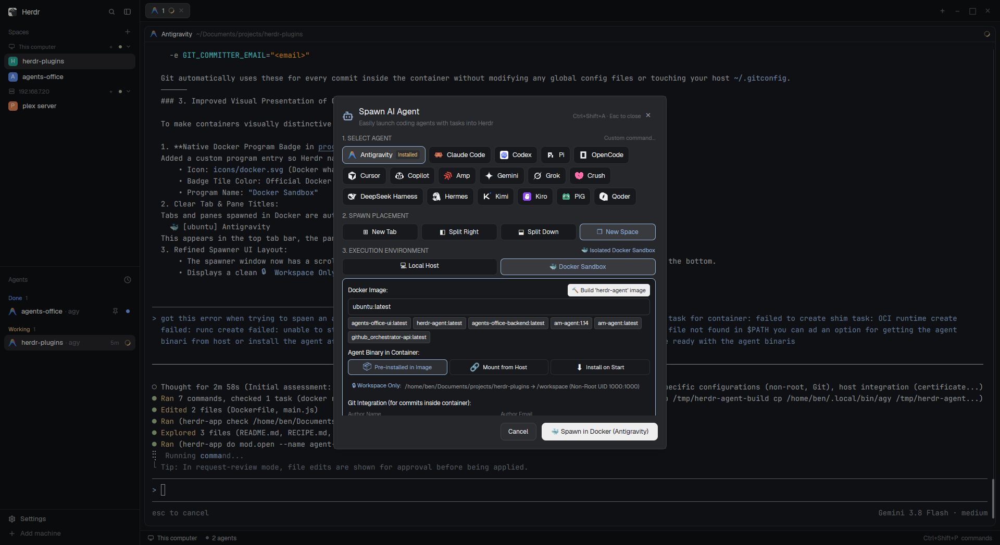

# Agent Spawner Plugin for Herdr

An interactive AI Agent Spawner mod for [Herdr](https://herdr.dev).

Easily launch and orchestrate AI coding agents (Antigravity, Claude Code, Codex, Cursor, Gemini, Copilot, Aider, custom scripts) directly into your Herdr workspace with initial task prompts, target placement options, and project directory selection.



## Features

- **Multi-Agent Support**: Automatically detects installed agents (e.g. Antigravity `agy`, Claude Code `claude`, Codex, Cursor, Gemini, Copilot, etc.) and allows entering custom CLI commands with arbitrary flags.
- **Multi-Machine & Remote Spawning**:
  - Target **This Computer (Local Host)** or any connected remote machine (e.g. `192.168.7.20`, server nodes) connected to Herdr.
  - Automatically queries connected nodes via `machines()` and `hc machine ls`.
  - Dynamically queries installed agents on the selected machine using `knownAgents({ on: machine })`.
  - Spawn directly into the remote machine's native host shell, or inside an isolated Docker container on that machine.
  - Direct directory typing for remote paths (`~`, `/srv/project`, etc.) with OS folder picker on local host.
  - **In-Modal Interactive Directory Tree**:
    - Real-time directory tree browser directly inside the spawner modal for any remote host.
    - Lazy-loads folder contents on demand via `find` without lag.
    - Clickable breadcrumbs (`Root › home › ben › Documents › ...`) to jump to any parent level in one click.
    - Quick actions: `🏠 Home`, `⬆ Up`, `👁️ Hidden (show/hide dotfiles)`, `🔄 Refresh`, and `📂 Hide/Show Tree`.
    - Single click on any folder selects it as the workspace directory and expands its subfolders.
  - Intelligent cross-machine placement routing (`space.new`, `tab.new`, fallback for pane splits).
- **Docker Container Sandbox**:
  - Run agents inside isolated Docker containers without root privileges (`docker run -it --rm --user ${UID}:${GID} -e HOME=/tmp`).
  - Runs strictly as the non-root host user inside the container.
  - Files created in mounted workspace directories are owned by the host user, never root.
  - Automatically mounts the active workspace directory to container `/workspace` (`-v ${cwd}:/workspace -w /workspace`).
  - **Complete Host Separation**: No mounting of host home directories (`~/.gemini`, `~/.anthropic`) by default.
  - **Git Identity Integration**: Directly configure Git Author Name & Email in the spawner window, injected via environment variables (`GIT_AUTHOR_NAME`, `GIT_COMMITTER_NAME`, `GIT_AUTHOR_EMAIL`, `GIT_COMMITTER_EMAIL`).
  - **Host SSL Certificates**: Optional 1-click toggle to mount host root certificates (`/etc/ssl/certs:ro`) to eliminate SSL/TLS handshake errors on minimal images.
  - **Pre-install Setup Script**:
    - Custom command line input (e.g. `apt-get update && apt-get install -y curl ca-certificates git`) that runs as root inside the container *before* the agent starts.
    - Resolves missing tools on minimal images like `ubuntu:latest` where `curl` or `git` are not installed.
    - Quick-fill preset chips: `📦 apt curl & git`, `🐍 python3 & pip`, `🟢 nodejs`, and `✕ Clear`.
    - Seamlessly auto-installs the agent (e.g. `agy`) right after `curl` is installed.
    - Option to drop privileges to the host UID after pre-install or run the agent as root.
  - **3 Agent Binary Strategies**:
    - `Pre-installed in Image`: Uses `herdr-agent:latest` or custom image with binaries pre-baked.
    - `Mount from Host`: Mounts `~/.local/bin/agy` read-only into `/usr/local/bin/agy:ro`.
    - `Auto-install on Start`: Injects a bootstrap shell hook to install missing binaries on container boot.
  - **In-Window Image Builder**: One-click `🔨 Build 'herdr-agent' Image` button inside the dialog that builds an optimized Ubuntu-based agent image with `agy`, `git`, `curl`, and `ca-certificates`.
  - **Meaningful Container Naming**: Automatically names container `--name herdr-agent-<space>-<agent>-<id>` and labels it with `herdr.agent=true` for instant filtering and discovery in the Docker Dashboard.
  - **Visual Distinction in Herdr**: Tab/pane titles formatted with `🐳 [<image>] <agent>` and recognized via `programs.json` with Docker's signature blue badge and whale icon.
  - Discovers local Docker images and provides quick preset chips (`herdr-agent:latest`, `ubuntu:latest`, `node:20`, `python:3.12`, etc.).
- **Flexible Target Placement**:
  - `⊞ New Tab`: Launches agent in a dedicated tab in the current space.
  - `◧ Split Right`: Splits the active pane vertically for side-by-side terminal monitoring.
  - `⬓ Split Down`: Splits horizontally beneath the active pane.
  - `❐ New Space`: Creates a new isolated space.
- **Task & Prompt Presets**: Quick-fill buttons for common workflows:
  - 🐛 Fix Bug / Diagnosing errors
  - 🧪 Add Unit Tests
  - 🔍 Code Review & git diff inspection
  - ⚡ Refactoring & optimization
  - 📖 Explaining codebase architecture
- **Directory Picker**: Defaults to active repo root with 1-click folder selection via `pickFolder()`.
- **Task History**: Automatically retains your last 5 prompts for rapid re-use.
- **Keyboard-First**:
  - `Ctrl+Shift+A`: Toggle spawner dialog anywhere in Herdr.
  - `Enter`: Spawn selected agent.
  - `Esc`: Close dialog.

## Installation

1. Copy or symlink `agent-spawner` into your Herdr mods directory:
   ```bash
   ln -s /path/to/herdr-plugins/agent-spawner ~/.config/herdr-app/mods/agent-spawner
   ```
2. Bind `Ctrl+Shift+A` in `~/.config/herdr-app/keys.json` under `"global"`:
   ```json
   "global": {
     "ctrl-shift-a": "mod.open:agent-spawner"
   }
   ```
3. Test with:
   ```bash
   herdr-app check ~/.config/herdr-app/mods/agent-spawner
   ```

## License

MIT
