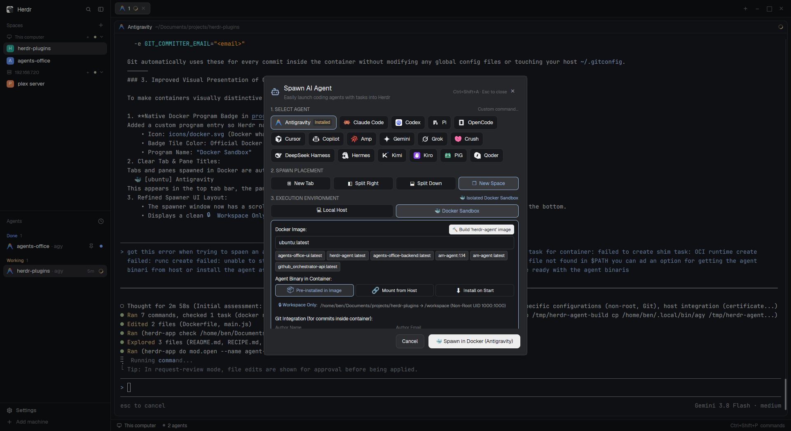

# Agent Spawner

A quick-launch overlay dialog for Herdr to spawn any AI coding agent with a task prompt into a new tab, split pane (right or down), or separate workspace.

## What you see

A modal dialog (620×560 px) over the Herdr workspace with theme background (`popover`) and borders:
- **Header**: Bot icon, title "Spawn AI Agent", subtitle, shortcut badge `Ctrl+Shift+A · Esc to close`, and an `✕` close button.
- **Agent Selector**: Horizontal flex-wrap grid of agent badges (Antigravity, Claude Code, Codex, Cursor, Gemini, Copilot, etc.) with their icons, name, and an "Installed" pill. In the header right, a "Custom command..." link toggles an open text input to execute arbitrary CLI commands.
- **Spawn Placement**: 4 segmented button choices:
  - `⊞ New Tab` (default)
  - `◧ Split Right`
  - `⬓ Split Down`
  - `❐ New Space`
- **Execution Environment**:
  - `💻 Local Host`: Runs directly in host terminal shell.
  - `🐳 Docker Container`: Spawns the agent inside an isolated Docker container:
    - Runs non-root as host user (`--user ${UID}:${GID} -e HOME=/tmp`).
    - Mounts project workspace to `/workspace` (`-v ${cwd}:/workspace -w /workspace`).
    - Image selector with local image auto-discovery and quick chips (`herdr-agent:latest`, `ubuntu:latest`, `node:20`, `python:3.12`).
    - Binary strategy radio: `Pre-installed in Image` / `Mount from Host` / `Auto-install on Start`.
    - One-click `🔨 Build 'herdr-agent' Image` button to package an image ready with the agent binary and SSL certs.
    - Git Author Name and Email fields passed via environment variables.
    - Host SSL Root Certificates toggle (`-v /etc/ssl/certs:/etc/ssl/certs:ro`).
    - API Key input and optional extra Docker flags.
- **Working Directory**: Displays current git repo / workspace folder with a folder icon and a `Change...` button to pick any directory via native folder picker.
- **Initial Task / Prompt**: A text input box for the initial prompt/task, accompanied by quick preset chips (`🐛 Fix Bug`, `🧪 Add Tests`, `🔍 Code Review`, `⚡ Refactor`, `📖 Explain`) and recent prompt history chips.
- **Footer**: `Cancel` button (Esc) and primary solid action button `🚀 Spawn <AgentName>` (Enter).

## How it behaves

- Opens via `Ctrl+Shift+A`, `herdr-app do mod.open --name agent-spawner`, or from any mod/menu calling `openOverlay({ mod: "agent-spawner", kind: "dialog" })`.
- Clicking any agent badge selects it, updating the border and the action button label (`🚀 Spawn <AgentName>`).
- Clicking preset buttons immediately inserts the prompt into the input field.
- Submitting (pressing Enter in prompt or clicking `🚀 Spawn`) closes the overlay, saves the prompt to recent history, and calls:
  - `tab.new` if placement is `New Tab`
  - `pane.split` if placement is `Split Right` or `Split Down`
  - `space.new` if placement is `New Space`
- Esc closes the dialog without spawning.

## Built from

- `main.js`: Main view extending `View` from `gpui-kit`.
- `mod.json`: Configures overlay dimensions (620×560) and `"place": "none"`.
- `herdr` API functions:
  - `knownAgents({ on: machine })` to list recognized agents and detect installations.
  - `spaces()`, `panes()`, `focused()` to detect the active workspace and folder.
  - `run(command, args)` to execute `tab.new`, `pane.split`, and `space.new`.
  - `pickFolder({ prompt })` for native folder selection.
  - `closeOverlay(id)` to dismiss the dialog.
  - `shared()`, `setShared()` for caching agents, history, and last choices.
  - `notify()` to post a feedback toast on launch.

## Watch out

- Warm-start agent cache from `shared("new-menu.agents")` and `shared("agent-spawner.agents-cache")` so the dialog never flashes a "Loading..." state on open.
- Antigravity CLI (`agy`) requires `-i` / `--prompt-interactive` to pass an initial prompt in interactive mode. Without it, `agy` rejects the prompt as an unexpected positional argument.
- Base Docker images (like `ubuntu:latest`) often lack `ca-certificates` by default, which causes HTTPS token verification to fail with `x509: certificate signed by unknown authority`. Mounting `-v /etc/ssl/certs:/etc/ssl/certs:ro` resolves this across all containers.
- Aider CLI uses `--message` for prompts.
- Ensure `track_focus(this.handle)` is mounted on the root container so `Esc` and `Enter` key events are caught immediately.

## Done when

- `herdr-app check <path>` succeeds with code 0.
- `herdr-app do mod.open --name agent-spawner` opens the dialog overlay cleanly.
- `Ctrl+Shift+A` toggles the dialog from anywhere in Herdr.
- Selecting an agent and clicking spawn launches a new terminal/agent session in the chosen target.
