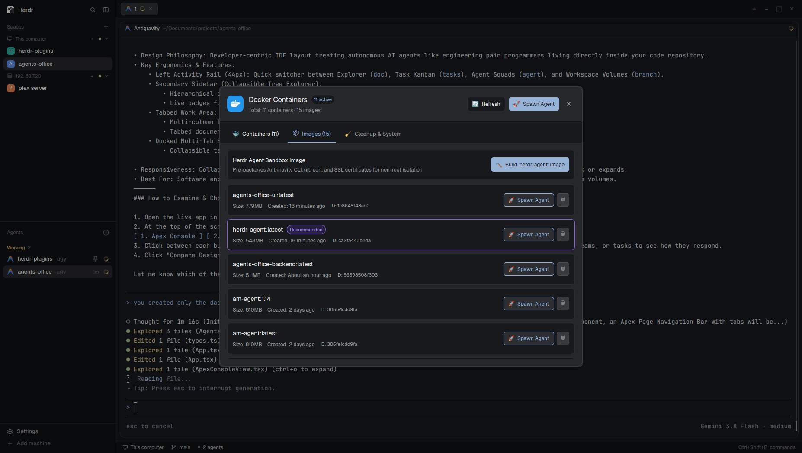

# Docker Dashboard Plugin for Herdr

A real-time Docker Container & Image Dashboard mod for [Herdr](https://herdr.dev).

Inspect, manage, and interact with all your Docker containers, images, and AI agent sandboxes directly from inside Herdr.



## Features

- **Live Container Monitoring**:
  - Displays all running and stopped Docker containers with live status indicators, uptime, and port mappings.
  - Live CPU % and RAM usage from `docker stats` updated dynamically.
  - Automatically recognizes and highlights **AI Agent Sandboxes** (Antigravity, Claude Code, etc.).
- **Native Terminal Shell Integration**:
  - `>_ Shell`: Launches an interactive container terminal shell directly in a new Herdr tab (`docker exec -it <id> sh`).
  - `📜 Logs`: Opens live streaming container logs (`docker logs -f --tail 250 <id>`) in a new Herdr tab.
- **Container Lifecycle Controls**:
  - Start, Stop, Restart, and Remove containers with one click.
  - Detailed container inspection drawer with formatted configuration, mounts, network settings, and raw JSON.
- **Image Management & Quick Spawning**:
  - Lists local Docker images, tags, sizes, and creation age.
  - `🚀 Spawn Agent`: One-click button next to any Docker image to open the `agent-spawner` dialog with that image pre-selected.
  - `🔨 Build 'herdr-agent' Image`: Build an optimized, non-root agent container image with CA certificates and CLI tools pre-installed.
  - Delete unused images.
- **Storage Cleanup & Pruning**:
  - View real-time disk usage with `docker system df`.
  - One-click actions to prune stopped containers, dangling images, and system caches.
- **Search & Quick Filters**:
  - Top row: segmented quick filter chips: `All`, `Running`, `Stopped`, and `🤖 Agent Sandboxes` (auto-detects `herdr-agent-*` and custom agent containers).
  - Bottom row: full-width search input to filter containers by name, image, or container ID.
- **Two-Tier Responsive Header**:
  - Line 1: Docker branding, active container count badge, and quick close button `✕`.
  - Line 2: Summary counter with dedicated `🔄 Refresh` and `🚀 Spawn Agent` action buttons.
- **Dual Mode (Dockable Sidebar or Floating Dialog)**:
  - **Dockable Sidebar**: Integrated directly into Herdr's window layout. Slides in and out seamlessly on the right side of the screen without covering your active terminal workspace.
  - **Floating Dialog**: Can also be triggered as a centered overlay.
  - **Resizable**: Drag the left boundary of the sidebar to make it narrower or wider; Herdr preserves your preferred width automatically.
- **Instant Controls & Quick Toggle**:
  - <kbd>Ctrl</kbd>+<kbd>Shift</kbd>+<kbd>D</kbd>: Toggle the Docker sidebar instantly from anywhere in Herdr.
  - **Status Bar Indicator**: Click `🐳 Docker` in the bottom status bar to open or close the sidebar.
  - <kbd>Esc</kbd> or `✕`: Dismisses the sidebar or overlay.

## Installation

### Mode A: Dockable Sidebar (Recommended)

1. Clone or copy `docker-dashboard` and `layouts/main-custom.json`:
   ```bash
   cp -r /path/to/herdr-plugins/docker-dashboard ~/.config/herdr-app/mods/
   mkdir -p ~/.config/herdr-app/layouts
   cp /path/to/herdr-plugins/layouts/main-custom.json ~/.config/herdr-app/layouts/
   ```

2. Switch Herdr to the custom layout:
   ```bash
   herdr-app do layout.switch --name main-custom
   ```

3. Bind <kbd>Ctrl</kbd>+<kbd>Shift</kbd>+<kbd>D</kbd> in `~/.config/herdr-app/keys.json` under `"global"`:
   ```json
   "global": {
     "ctrl-shift-d": "layout.toggle:docker-sidebar"
   }
   ```

---

### Mode B: Floating Dialog Modal

1. Clone or symlink `docker-dashboard` into your Herdr mods directory:
   ```bash
   ln -s /path/to/herdr-plugins/docker-dashboard ~/.config/herdr-app/mods/docker-dashboard
   ```
2. Bind <kbd>Ctrl</kbd>+<kbd>Shift</kbd>+<kbd>D</kbd> in `~/.config/herdr-app/keys.json` under `"global"`:
   ```json
   "global": {
     "ctrl-shift-d": "mod.open:docker-dashboard"
   }
   ```
3. Verify:
   ```bash
   herdr-app check ~/.config/herdr-app/mods/docker-dashboard
   ```

## License

MIT
