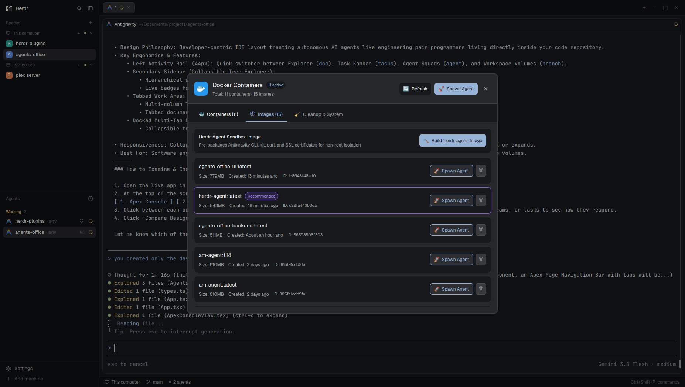

# Docker Dashboard

A full-featured Docker container and image management dashboard for Herdr.

## What you see

A modal window (840×650 px) over the Herdr workspace:
- **Header**: Docker logo with blue badge, active container counters (`● X active`, `Total: Y containers · Z images`), `🔄 Refresh` button, `🚀 Spawn Agent` button, and `✕` close button.
- **Tabs**:
  - `🐳 Containers (X)`: List of containers with filter chips and search.
  - `📦 Images (Y)`: List of local images with sizes, tags, and quick spawn actions.
  - `🧹 Cleanup & System`: Docker disk usage (`docker system df`) and prune actions.
- **Container Cards**:
  - Running/Stopped status dot and uptime description.
  - Container name, short ID, image badge, and `🤖 Agent Sandbox` pill for agent containers.
  - Port mappings and volume mounts.
  - Live CPU % and RAM usage.
  - Actions: `>_ Shell`, `📜 Logs`, `🔍 Inspect`, `🔄 Restart`, `⏹ Stop` / `▶ Start`, `🗑 Remove`.
- **Inspect Overlay**:
  - Click `🔍 Inspect` on any container to open a detailed breakdown of IP address, WorkingDir, mounts, and full inspect JSON.

## How it behaves

- Opens via <kbd>Ctrl</kbd>+<kbd>Shift</kbd>+<kbd>D</kbd>, clicking the `🐳 Docker` indicator in the bottom status bar, or via `herdr-app do layout.toggle --id docker-sidebar`.
- Slides out as a dedicated collapsible sidebar on the right of the workspace.
- The sidebar is resizable by dragging its edge, and Herdr remembers your chosen width across sessions.
- Automatically polls container state and live stats every 4 seconds in the background.
- Clicking `>_ Shell` immediately spawns an interactive container terminal shell inside a new Herdr tab using `tab.new`.
- Clicking `📜 Logs` launches a follow stream of container output in a new Herdr tab.
- Pressing `Esc` or clicking `✕` hides the sidebar.

## Built from

- `main.js`: Main view subclassing `View` from `gpui-kit`.
- `mod.json`: Configures overlay dimensions (840×650) and `"kind": "dialog"`.
- `herdr` API functions:
  - `exec("docker", ...)` to interact with the Docker CLI daemon.
  - `run("tab.new", ...)` to open native terminal shells and logs.
  - `run("mod.open", ...)` to bridge with `agent-spawner`.
  - `notify(...)` for real-time operation feedback.
  - `theme()` for theme-aware styling.

## Done when

- `herdr-app check ~/.config/herdr-app/mods/docker-dashboard` succeeds with code 0.
- `Ctrl+Shift+D` opens the dashboard overlay cleanly.
- Container list displays live CPU/memory stats and supports opening shells and logs into Herdr tabs.
